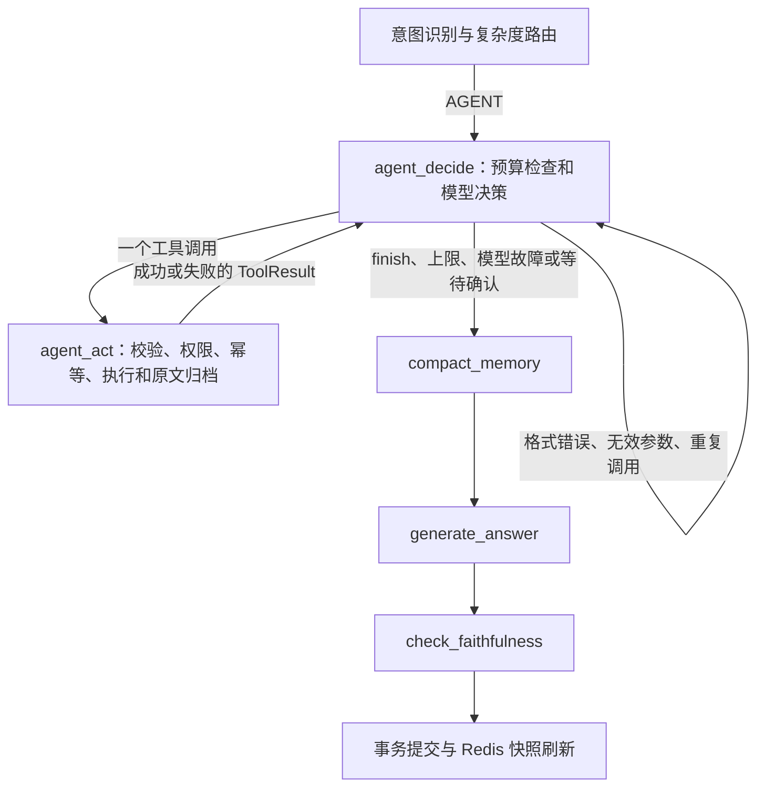

# Agent Loop

AGENT 分支使用观察驱动的循环，不再一次生成多步计划。DIRECT、SINGLE、MULTI、REFUSE 仍由原来的路由处理。



## 一轮决策

`app/agents/nodes/agent_loop.py` 的 `agent_decide_node` 每轮重新构建模型输入：当前问题、可见历史、摘要、完整工具参数 Schema、技能允许的工具、本轮累计工具观察、已调用参数、最近 10 条历史结果目录、执行反馈及剩余预算。技能只作为参考和工具范围约束，不再展开成固定步骤。

使用现有 Provider 的 JSON 输出协议，每轮只允许以下两种决策。没有新增 SDK，也不依赖 Provider 原生 function calling；这是应用层的工具调用循环。

```json
{"action":"tool","tool_name":"get_order","arguments":{"order_id":"ORD1001"}}
```

```json
{"action":"finish"}
```

例如查询订单并判断是否需要查物流：先调用 `get_order`，模型读取真实返回状态和标识，再决定调用 `track_shipment`、补查政策、要求澄清，或直接结束。下一次调用的参数可以来自上一次观察，程序不会预先固定整条工具链。

## 执行与恢复

`agent_act_node` 每次仅执行当前决策选择的一个工具，共用 `executor.py` 的执行基础设施。成功和失败结果都累计到 `tool_results`，下一轮会重新观察。这个分支关闭执行层的自动备用工具链：失败后由模型决定修正参数、换工具或结束。

超过归档阈值的工具结果继续写入数据库 `tool_outputs`，压缩预览保留 `result_ref`。模型需要细节时直接调用 `load_tool_result`，读取一页后再判断是否需要下一页。业务工具和加载工具共享调用预算；不会为了恢复原文重放业务操作。加载权限仍限制为当前用户和当前会话。

每轮决策与最终回答共用 `ContextBuilder.build_answer`。决策阶段计入工具目录、历史、原始工具输出等实际提示内容，并预留 512 tokens 输出；最终回答预留 700。128k 及 50% / 70% / 85% 压缩机制继续生效，计数仍是原有的字符估算。循环内的决策轨迹保存在请求 State；工具原文持久化，循环执行位置本身没有新增 checkpoint 或断点续跑。

## 退出与限制

- `MAX_AGENT_STEPS=8`：最多 8 次模型决策，格式错误、无效参数和重复调用也消耗轮数。
- `MAX_TOOL_CALLS=6`：整个请求最多执行 6 次工具调用，失败调用和原文加载均计入。
- 参数先经过工具的 Pydantic Schema 校验，并应用默认值后生成调用指纹。相同工具、相同规范化参数不重复执行；不同分页 offset 可以继续加载。
- 模型返回 `finish`、模型不可用、预算耗尽或等待写操作确认时退出循环。达到上限或故障的原因会传入回答阶段，要求说明未完成事项。
- LangGraph 递归上限随决策轮数配置，留出前置路由和后置回答节点的空间。
- 写操作继续返回 `pending_action`，带确认标识的请求沿用已有确认和幂等机制。一次请求最多尝试一次已确认的写操作，后续写操作必须重新确认。这里没有新增服务端确认凭证与工具参数的绑定校验，现有 `confirm_action_id` 机制的信任边界仍需由调用端保证。

循环结束后统一生成最终回答并检查忠实度。SSE 会逐次发送 `agent_decide` / `agent_act` 节点事件，决策 JSON 不作为回答 token 输出。会话、摘要、工具原文仍按原事务流程提交，提交后刷新 Redis。

旧 `planner.py` 和 `executor_node` 保留给兼容调用，主图已经不再注册 `plan_tasks` / `execute_tools`。新增循环不创建 `AgentPlan`。

按用户要求本次未运行测试。原来断言 Planner 节点或旧计划输出的测试夹具需要按新协议调整后才能用作新循环的验收依据。
