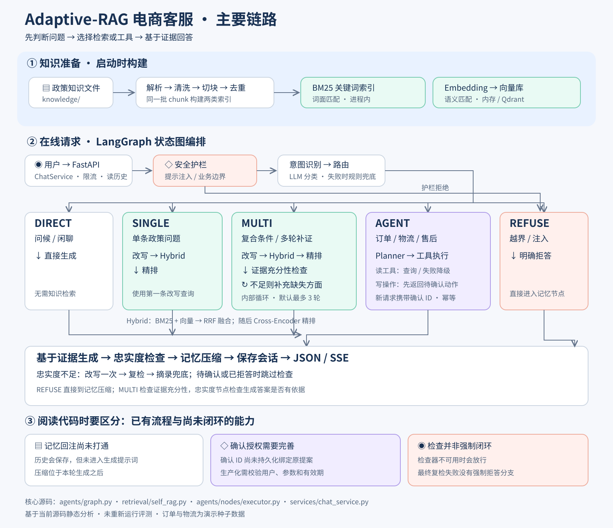

# Adaptive-RAG 项目主要链路解析

本说明基于当前仓库源码静态分析，未运行服务或重新执行评测。配图为主要流程的教学概览，具体行为以代码为准。

## 1. 项目解决什么问题

这是一个基于 FastAPI、LangGraph 和混合检索的电商客服工程演示。它既回答政策问题，也通过工具查询订单、物流以及执行售后操作。核心设计是先识别意图和问题复杂度，再选择 DIRECT、SINGLE、MULTI、AGENT 或 REFUSE。

LangGraph 中有 10 个节点；所谓多智能体在代码中主要体现为分类、路由、规划、执行、生成、检查等职责节点共享 AgentState，由固定状态图编排。

## 2. 知识准备链路

`build_container → build_retrieval → ingest_knowledge`

启动时扫描知识文件，解析、清洗、切块，并按 chunk 去重。相同 chunk 同时用于构建 BM25 索引，以及计算 Embedding 后写入向量库。配置 Qdrant 时优先使用它，写入失败则退回内存向量库。BM25 始终是进程内组件。

关键代码：`app/services/container.py`、`app/retrieval/ingest.py`、`app/retrieval/unstructured_parser.py`。

## 3. 在线请求总链路

`POST /api/v1/chat → ChatService → 限流 → 读取近期消息 → 初始化 AgentState → LangGraph → 保存消息并提交事务 → JSON 响应`

流式入口为 `/api/v1/chat/stream`，提供 started、node、token、answer、done 事件。token 事件出现在生成期间，忠实度检查在其后，因此客户端应以最终 answer 事件作为最终答案，前面的 token 可能随后被纠正。

图中的关键顺序：

1. `apply_guardrail`：检查注入和业务边界；拒绝时直接走 `refuse_answer → compact_memory`。
2. `classify_intent`：识别问候、政策、订单、物流、售后等意图。
3. `route_complexity`：选择五种策略。优先采用 LLM 结构化分类，模型调用或解析失败时才使用规则兜底。复杂度在当前 schema 中是类别枚举，并非 README 图示里的连续 0–1 分数。
4. 运行检索、工具或直答分支。
5. 生成后检查忠实度，再压缩记忆并结束图执行。

关键代码：`app/api/routes/chat.py`、`app/services/chat_service.py`、`app/agents/graph.py`、`app/retrieval/adaptive.py`。

## 4. 五个分支分别做什么

| 策略 | 示例诉求 | 实际执行 |
|---|---|---|
| DIRECT | 你好 | 直接进入生成节点，不检索 |
| SINGLE | 一条退货政策是什么 | 改写问题，取第一条改写，Hybrid 召回，再精排 |
| MULTI | 多个政策条件需要交叉判断 | 改写、召回、精排、检查证据是否充分；缺失时下一轮补证 |
| AGENT | 查订单、取消订单 | Planner 生成步骤，Executor 调注册工具，再生成回答 |
| REFUSE | 越界请求 | 拒答后压缩记忆，不进入生成与忠实度检查 |

这些是典型场景，不保证某句自然语言永远命中固定策略；实际取决于分类结果，规则兜底还会优先将多类交易意图送到 AGENT。

### SINGLE：一次混合检索

`QueryRewriter → rewritten[0] → HybridRetriever → DocumentReranker → generate_answer`

Hybrid 内部先运行 BM25，再 await 向量搜索，最后 RRF 融合并截取 top_k；当前实现不是并发双路召回。BM25 关注词面命中，向量检索关注语义相似，RRF 按名次合并，Cross-Encoder 再对问题与候选文本进行精排。检索缓存命中时直接返回缓存候选。

### MULTI：围绕缺失证据逐轮补充

`改写 → 第一条改写的 Hybrid 检索 → 精排 → 按 chunk_id 累积去重 → LLM 评价充分性`

充分则停止，否则把 missing_aspect 交给下一轮改写；达到 max_retrieval_hops 也会结束。这是有轮数上限的检索补证循环，循环封装在 SelfRAGLoop 内部，Graph 自身没有检索回边。当前没有把全部改写查询并发执行。

关键代码：`app/agents/nodes/retrieval.py`、`app/retrieval/hybrid.py`、`app/retrieval/self_rag.py`。

### AGENT：规划、执行与确认

Planner 按意图匹配项目 JSON Skill，限制可用工具并生成计划；模型失败时可用 Skill 步骤或知识检索计划兜底。Executor 按计划顺序调用 ToolRegistry 中的工具；部分读工具失败时尝试预设替代工具。

取消订单等写操作第一次产生 pending_action，Executor 本轮不执行计划。用户后续提交 confirm_action_id 后，新请求重新进入分类与规划，再在执行前检查风险和幂等键。已有相同指纹的幂等记录时返回原结果，避免重复执行。

需要区分演示机制与生产授权：当前 Planner 并未持久化并绑定原提案，Executor 主要用确认 ID 是否非空判断已确认。生产化需要保存提案并校验确认 ID、用户、会话、工具参数及有效期，才能证明用户确认的就是将执行的操作。

关键代码：`app/agents/nodes/planner.py`、`app/agents/nodes/executor.py`、`app/tools/permissions.py`、`app/repositories/idempotency.py`。

## 5. 生成、检查与记忆

生成节点把当前问题、意图、策略、最多前 6 个检索 chunk 和工具结果组织为提示词，让模型返回答案及引用 chunk_id，再映射为 citations。待确认动作直接返回确认提示。

忠实度检查发现缺乏支持时，内部先尝试一次 LLM 改写并复检，仍不通过或调用失败则使用摘录式兜底并再检查。当前代码没有“最后一次检查仍失败便强制 REFUSE”的条件边，也没有在纠错后同步重建 citations。不能把这个机制解读为所有输出都已被严格验证。

记忆节点位于生成之后，按预算分级处理历史和工具结果。但当前 generate_node 的提示词未使用历史 messages 或 summary；ChatService 初始化时 summary 也始终为空，没有读取已保存摘要。因此数据库留存会话和压缩节点已经存在，完整的多轮记忆回注尚未打通，也不能据此声称生成前上下文预算已被控制。

此外，FaithfulnessChecker 调用或解析失败时会返回 `supported=True`（checker_unavailable），当前行为是放行，不能视为检查通过的证据。

关键代码：`app/agents/nodes/generate.py`、`app/agents/nodes/faithfulness.py`、`app/guardrails/hallucination.py`、`app/agents/nodes/memory.py`、`app/services/chat_service.py`。

## 6. 怎样理解这个项目的价值

它最值得学习的是：用显式状态图管理分支，用混合召回和精排组织证据，把复杂问题变成有限次补证，把业务动作封装成有权限与幂等机制的工具，并通过 JSON/SSE、日志和指标让执行可观察。

它仍是工程演示：订单和物流使用种子数据；没有配置生成模型时使用 FakeLLMProvider；记忆回注、确认授权绑定、纠错后的引用一致性仍需完善。README 中的历史评测数据不代表本次重新验证的结果。

建议源码阅读顺序：`container.py → chat_service.py → graph.py → nodes/retrieval.py → hybrid.py / self_rag.py → nodes/planner.py / executor.py → nodes/generate.py / faithfulness.py`。
